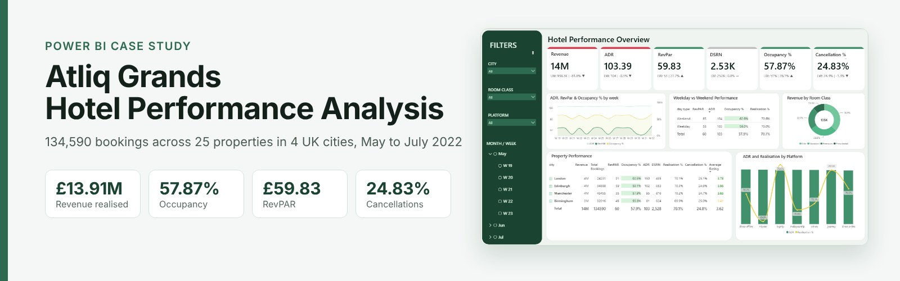
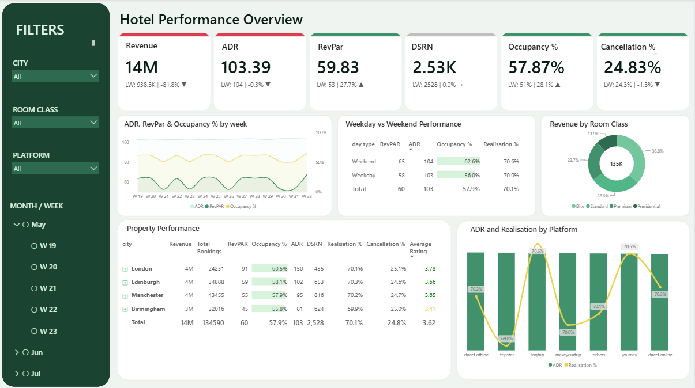
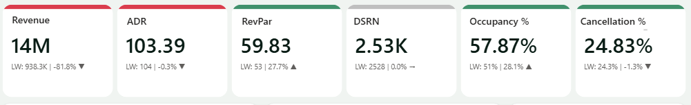
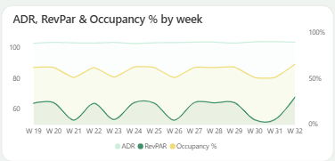
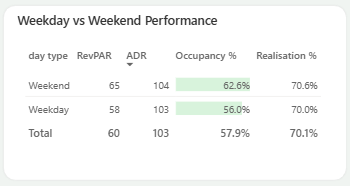
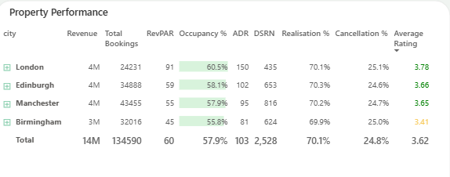
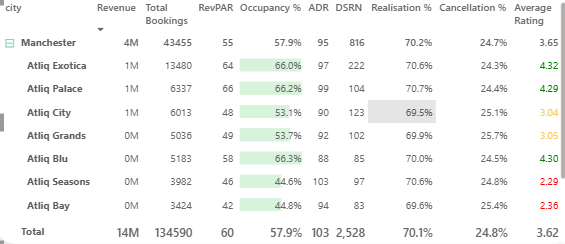
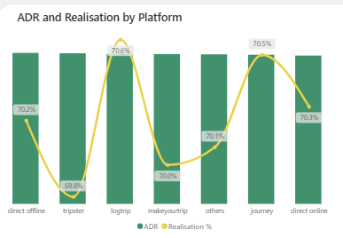
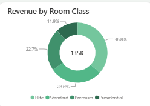
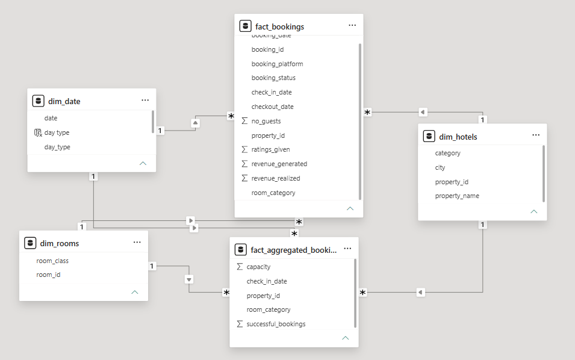

[Overview](#overview) · [Business context](#business-context) · [Project journey](#project-journey) · [Key insights](#key-insights) · [Business questions](#business-questions) · [Data model](#data-model-and-logic) · [Skills](#skills-demonstrated) · [Gallery](#screenshot-gallery) · [Repository](#repository-structure) · [Author](#about-the-author)

## Overview

A one-page Power BI dashboard that tracks revenue, occupancy, pricing and booking quality for 25 hotels in 4 UK cities from 1 May to 31 July 2022.


[](https://app.powerbi.com/view?r=eyJrIjoiNzM4MmVkNzItZjczYy00ZTk0LWIyYmItMTJkNzI5MjA0ODBjIiwidCI6ImM2ZTU0OWIzLTVmNDUtNDAzMi1hYWU5LWQ0MjQ0ZGM1YjJjNCJ9)


| Revenue realised | Bookings | Occupancy | ADR | RevPAR | Cancellation rate |
|---|---|---|---|---|---|
| £13.91M | 134,590 | 57.87% | £103.39 | £59.83 | 24.83% |

## Business context

Atliq Grands is a fictional hotel chain with 25 properties in London, Manchester, Edinburgh and Birmingham. All figures come from a sample dataset. Management wanted one page that shows how the business is performing and where it is losing ground.

| Team | Their question |
|---|---|
| Leadership | How is the portfolio performing overall? |
| Revenue management | How do the key metrics move week to week? Do weekends perform better? |
| Operations | Which cities and properties lead and lag, and does guest rating matter? |
| Distribution | Do booking platforms differ in rate or realisation? |
| Sales | What does the room class mix look like? |

## Project journey

| Phase | What I did | Result |
|---|---|---|
| 1. Data model | Loaded 5 tables and built a star schema with 2 fact tables and 3 dimensions | One date, hotel and room filter drives every visual |
| 2. KPI layer | Wrote 42 DAX measures in a dedicated measures table | ADR, RevPAR, occupancy, realisation, cancellation, DSRN, DBRN and DURN available everywhere |
| 3. First dashboard | Built cards, trend, tables and platform charts | All headline questions answered on one page |
| 4. Validation | Checked every KPI against the source data | Found and fixed missing room class relationships (every room class showed 25%) and booking share measures that were 100 times too large |
| 5. Redesign | Added week on week labels, accent colours that react to change, and a hierarchy slicer for month and week | Each card shows the latest value, last week and the direction of change |

## Key insights

| Finding | Evidence |
|---|---|
| Demand, not price, drives weekly swings | Occupancy fell from about 62% to about 51% in W21, W23, W26, W30 and W31, while ADR stayed between £102.81 and £104.01 |
| Weekends sell more rooms but not at higher prices | Weekend occupancy 62.64% vs 55.99% on weekdays; ADR £103.67 vs £103.26 |
| London earns the most per room | London RevPAR £90.88, double Birmingham at £45.22 |
| Manchester earns the most revenue through scale | £4.13M from 8 properties, the most in the portfolio |
| Guest rating tracks occupancy closely | 12 properties rated above 3.5 sold 65.60% to 66.40% of rooms; 4 rated 2.5 or below sold 44.40% to 44.84% |
| Platforms change volume, not value | ADR across 7 platforms sits between £102.47 and £104.32; realisation between 69.83% and 70.59% |
| Presidential rooms punch above their weight | 11.94% of bookings but 22.49% of revenue, at an ADR of £194.71 |

## Business questions

| # | Team | Question | Answer |
|---|---|---|---|
| Q1 | Leadership | How is the portfolio performing overall? | [£13.91M revenue, 57.87% occupancy](docs/walkthrough.md#q1-overall-performance) |
| Q2 | Revenue management | How do the key metrics move week to week? | [Occupancy swings 11.4 points; ADR flat](docs/walkthrough.md#q2-weekly-trend) |
| Q3 | Revenue management | Do weekends perform better than weekdays? | [+6.65 points occupancy, same ADR](docs/walkthrough.md#q3-weekday-vs-weekend) |
| Q4 | Operations | Which cities perform best? | [London RevPAR £90.88](docs/walkthrough.md#q4-city-performance) |
| Q5 | Operations | Which properties lead and lag, and does rating matter? | [Rating bands match occupancy bands](docs/walkthrough.md#q5-properties-and-guest-ratings) |
| Q6 | Distribution | Do booking platforms differ in rate or realisation? | [£1.85 ADR gap across platforms](docs/walkthrough.md#q6-booking-platforms) |
| Q7 | Sales | What does the room class mix look like? | [Presidential: 11.94% of bookings, 22.49% of revenue](docs/walkthrough.md#q7-room-class-mix) |

Full answer tables: [docs/business_answers.md](docs/business_answers.md) and [answers/](answers/).

## Data model and logic

```
                    dim_date (date, wn, day type)
                     1 |                    | 1
                       |                    |
                     * |                    | *
 dim_hotels 1 ---- * fact_bookings     fact_aggregated_bookings * ---- 1 dim_hotels
                       | *                  | *
                       |                    |
                     1 |                    | 1
                    dim_rooms (room_id, room_class)
```

| Table | Grain | Rows |
|---|---|---|
| fact_bookings | One row per booking | 134,590 |
| fact_aggregated_bookings | One row per property, room class and day | 9,200 |
| dim_date | One row per day | 92 |
| dim_hotels | One row per property | 25 |
| dim_rooms | One row per room class | 4 |

All 6 relationships are one-to-many with single-direction filtering.

```
Revenue        = SUM of realised revenue
ADR            = Revenue / Total Bookings
RevPAR         = Revenue / Total Capacity
Occupancy %    = Successful Bookings / Total Capacity
Realisation %  = 1 - (Cancellation % + No Show %)
DSRN           = Total Capacity / Number of days
Weekend        = Friday and Saturday nights
```

All measures: [dax/measures.dax](dax/measures.dax)

## Skills demonstrated

| Area | Skills |
|---|---|
| Data modelling | Star schema, 2 fact tables sharing 3 dimensions, calculated columns |
| DAX | 42 measures, CALCULATE and filter context, week on week comparison, dynamic text and colour measures |
| Power BI design | KPI cards with dynamic labels, conditional formatting, hierarchy slicer, combo and matrix visuals |
| Analysis | Hotel KPIs (ADR, RevPAR, occupancy, realisation), checking totals against source data, spotting model errors |

## Screenshot gallery

Click any image to open it full size.

| | |
|---|---|
| [](images/01_dashboard_full.png) | [](images/02_kpi_cards.png) |
| Full dashboard | KPI cards |
| [](images/03_weekly_trend.png) | [](images/04_weekday_weekend.png) |
| Weekly trend | Weekday vs weekend |
| [](images/05_city_performance.png) | [](images/06_property_performance.png) |
| City performance | Property drill-down |
| [](images/07_platform_adr_realisation.png) | [](images/08_room_class_mix.png) |
| ADR and realisation by platform | Room class mix |
| [](images/09_data_model.png) | |
| Data model | |

## Repository structure

```
Hotel-Performance-Analysis-PowerBI/
|-- README.md
|-- .gitignore
|-- .gitattributes
|-- docs/
|   |-- walkthrough.md          question, approach, DAX, screenshot, answer, insight
|   `-- business_answers.md     full answer tables
|-- dax/
|   `-- measures.dax            all 42 measures and 2 calculated columns
|-- answers/                    answer tables as CSV, one per question
|-- reports/
|   `-- Atliq_Grands_Hotel_Performance_Case_Study.pdf
`-- images/                     screenshots in build order
```

**How to explore it**

1. Open the [live dashboard](https://app.powerbi.com/view?r=eyJrIjoiNzM4MmVkNzItZjczYy00ZTk0LWIyYmItMTJkNzI5MjA0ODBjIiwidCI6ImM2ZTU0OWIzLTVmNDUtNDAzMi1hYWU5LWQ0MjQ0ZGM1YjJjNCJ9) and use the slicers on the left.
2. Read [docs/walkthrough.md](docs/walkthrough.md) for the logic behind each answer.
3. To rebuild the measures in your own model, create a `key_measures` table and paste the measures from [dax/measures.dax](dax/measures.dax).

**Notes on the data**

- 31 July is the only day in week 32. With no week selected, the card labels compare this one-day week with week 31, so their week on week changes are not like for like.
- Two Manchester properties share the name Atliq Exotica (IDs 16559 and 17559). Tables grouped by property name show them combined.

## About the author

**Muhammad Raheel Yousaf**, Data Analyst

[](https://github.com/mraheelyousaf4)
[](https://www.linkedin.com/in/muhammad-raheel-yousaf-da/)
[](https://app.powerbi.com/view?r=eyJrIjoiNzM4MmVkNzItZjczYy00ZTk0LWIyYmItMTJkNzI5MjA0ODBjIiwidCI6ImM2ZTU0OWIzLTVmNDUtNDAzMi1hYWU5LWQ0MjQ0ZGM1YjJjNCJ9)

## Acknowledgement

Atliq Grands is a fictional company. The dataset is sample data used for portfolio and learning purposes only.
