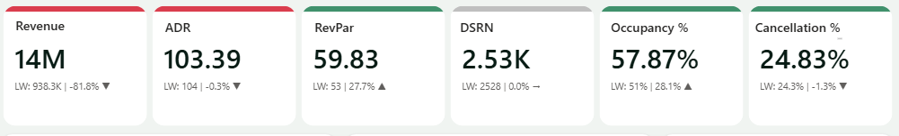
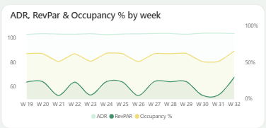
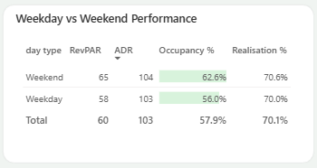
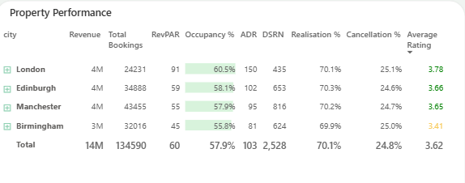
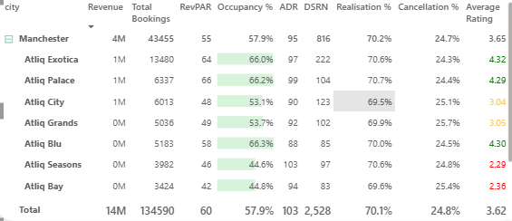
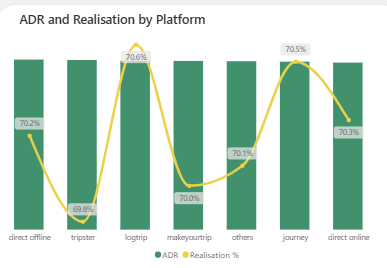
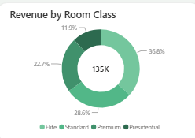

# Walkthrough

One section per business question: the question, how I answered it, the DAX behind it, the dashboard view, the answer and the insight.

Scope for every question: 25 properties, 1 May to 31 July 2022, unless stated. Full tables are in [business_answers.md](business_answers.md).

[Q1](#q1-overall-performance) · [Q2](#q2-weekly-trend) · [Q3](#q3-weekday-vs-weekend) · [Q4](#q4-city-performance) · [Q5](#q5-properties-and-guest-ratings) · [Q6](#q6-booking-platforms) · [Q7](#q7-room-class-mix)

---

## Q1 Overall performance

**Team:** Leadership
**Question:** How is the portfolio performing overall?

**Approach:** Six KPI cards at the top of the page. Each card shows the value for the current filters, last week's value and the week on week change, with an accent bar coloured by direction.

```DAX
ADR            = DIVIDE ( [Revenue], [Total Bookings], 0 )
RevPAR         = DIVIDE ( [Revenue], [Total Capacity], 0 )
Occupancy %    = DIVIDE ( [Total Succesful Bookings], [Total Capacity], 0 )
Realisation %  = 1 - ( [Cancellation %] + [No Show rate %] )
DSRN           = DIVIDE ( [Total Capacity], [No of days] )
```



**Answer:** £13.91M realised revenue from 134,590 bookings. Occupancy 57.87%, ADR £103.39, RevPAR £59.83, realisation 70.15%, cancellation rate 24.83%, 2,528 sellable room nights a day.

**Insight:** About one booking in four is cancelled, so realisation sits at 70.15%. Cancellations are the largest single drag on revenue.

---

## Q2 Weekly trend

**Team:** Revenue management
**Question:** How do the key metrics move week to week?

**Approach:** Line chart of ADR, RevPAR and occupancy by week number, with occupancy on a secondary axis. Week numbers sort by the numeric `wn` column so the axis stays in calendar order.

```DAX
dim_date[wn] = WEEKNUM ( dim_date[date] )
```



**Answer:** Across the 13 full weeks, occupancy ranged from 50.96% (W26) to 62.39% (W24), a gap of 11.4 points. ADR stayed between £102.81 and £104.01.

**Insight:** Five weeks (W21, W23, W26, W30, W31) dropped to about 51% occupancy. Because ADR barely moved, RevPAR fell with occupancy (£52.70 at its lowest against £64.26 at its highest). W32 holds only 31 July, so it is excluded from these ranges.

---

## Q3 Weekday vs weekend

**Team:** Revenue management
**Question:** Do weekends perform better than weekdays?

**Approach:** Table of RevPAR, ADR, occupancy and realisation split by a calculated day type column. In hotels the weekend means Friday and Saturday nights.

```DAX
dim_date[day type] =
    VAR wkd = WEEKDAY ( dim_date[date], 1 )   -- Sunday = 1 ... Saturday = 7
    RETURN IF ( wkd > 5, "Weekend", "Weekday" )
```



**Answer:** Weekend occupancy is 62.64% against 55.99% on weekdays (+6.65 points). Weekend RevPAR is £64.94 against £57.82. ADR is almost the same: £103.67 against £103.26.

**Insight:** Demand rises at weekends but prices do not. This points to room for weekend rate increases.

---

## Q4 City performance

**Team:** Operations
**Question:** Which cities perform best?

**Approach:** Matrix with city on rows and every core KPI as a column, with occupancy shown as data bars and rating coloured by band.



**Answer:** London leads on price and room yield: ADR £150.10, RevPAR £90.88, occupancy 60.55%. Manchester earns the most revenue (£4.13M) from 8 properties. Birmingham is lowest on ADR (£81.08), RevPAR (£45.22), occupancy (55.77%) and rating (3.41).

**Insight:** London earns twice Birmingham's revenue per available room. Manchester's revenue lead comes from scale, not yield: its RevPAR is £55.00.

---

## Q5 Properties and guest ratings

**Team:** Operations
**Question:** Which properties lead and lag, and does guest rating matter?

**Approach:** The same matrix expanded to property level, sorted by revenue. Average rating is coloured green at 3.5 or above, amber above 2.5 and red at 2.5 or below.

```DAX
Average Rating Txt Color =
SWITCH (
    TRUE (),
    ISBLANK ( [Average Rating] ), "Grey",
    [Average Rating] >= 3.5, "Green",
    [Average Rating] > 2.5, "#F8CD63",
    "Red"
)
```



**Answer:** Atliq Palace, London is the top property at £1.10M. Atliq Bay, Manchester is the lowest at £0.32M.

| Rating band | Properties | Occupancy range |
|---|---|---|
| Above 3.5 | 12 | 65.60% to 66.40% |
| 2.5 to 3.5 | 9 | 52.98% to 53.83% |
| 2.5 or below | 4 | 44.40% to 44.84% |

**Insight:** Every property sits in the occupancy band that matches its rating band, with no overlaps. The lowest-rated properties sell about 21 points fewer rooms than the highest-rated ones.

**Note:** Two Manchester properties share the name Atliq Exotica (IDs 16559 and 17559, £0.73M and £0.58M). The matrix groups by name, so it shows them combined as £1.31M.

---

## Q6 Booking platforms

**Team:** Distribution
**Question:** Do booking platforms differ in rate or realisation?

**Approach:** Combo chart with ADR as columns and realisation % as a line, by booking platform.

```DAX
Booking % by Platform =
DIVIDE ( [Total Bookings], CALCULATE ( [Total Bookings], ALL ( fact_bookings[booking_platform] ) ) )
```



**Answer:** ADR across all 7 platforms sits between £102.47 and £104.32, a gap of £1.85. Realisation sits between 69.83% and 70.59%. "Others" brings 40.91% of bookings, makeyourtrip 19.99%, and direct online and offline together 14.96%.

**Insight:** Platforms change how many bookings arrive, not what each booking is worth. The realisation line uses a zoomed axis, so differences under one point look larger than they are.

---

## Q7 Room class mix

**Team:** Sales
**Question:** What does the room class mix look like?

**Approach:** Donut chart of booking share by room class, compared with each class's share of revenue.

```DAX
Booking % by Room class =
DIVIDE ( [Total Bookings], CALCULATE ( [Total Bookings], ALL ( dim_rooms[room_class] ) ) )
```



| Room class | Share of bookings | Share of revenue | ADR |
|---|---|---|---|
| Elite | 36.78% | 32.35% | £90.92 |
| Standard | 28.57% | 18.46% | £66.82 |
| Premium | 22.71% | 26.70% | £121.55 |
| Presidential | 11.94% | 22.49% | £194.71 |

**Insight:** Presidential rooms earn nearly double their booking share in revenue. Standard rooms do the opposite: 28.57% of bookings for 18.46% of revenue.
